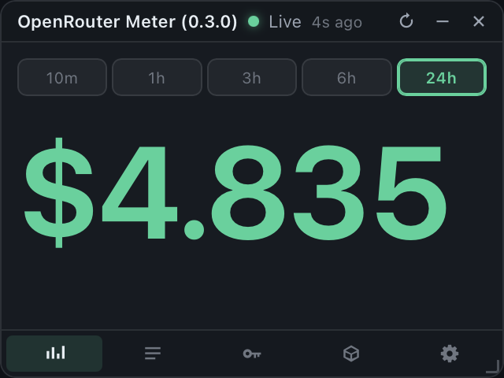
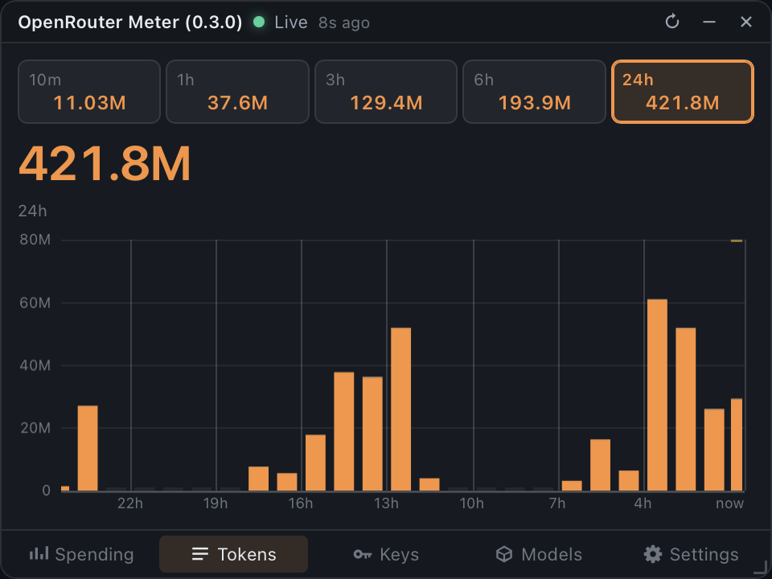
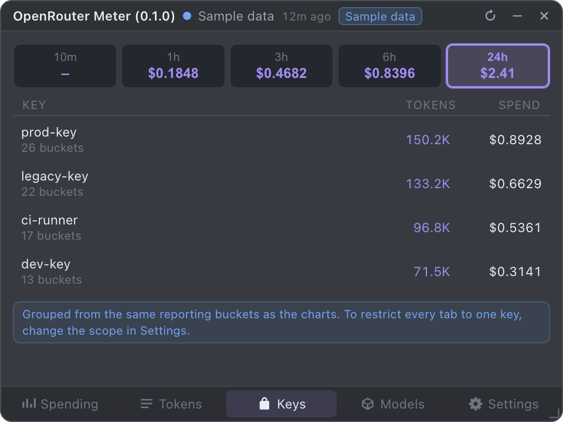
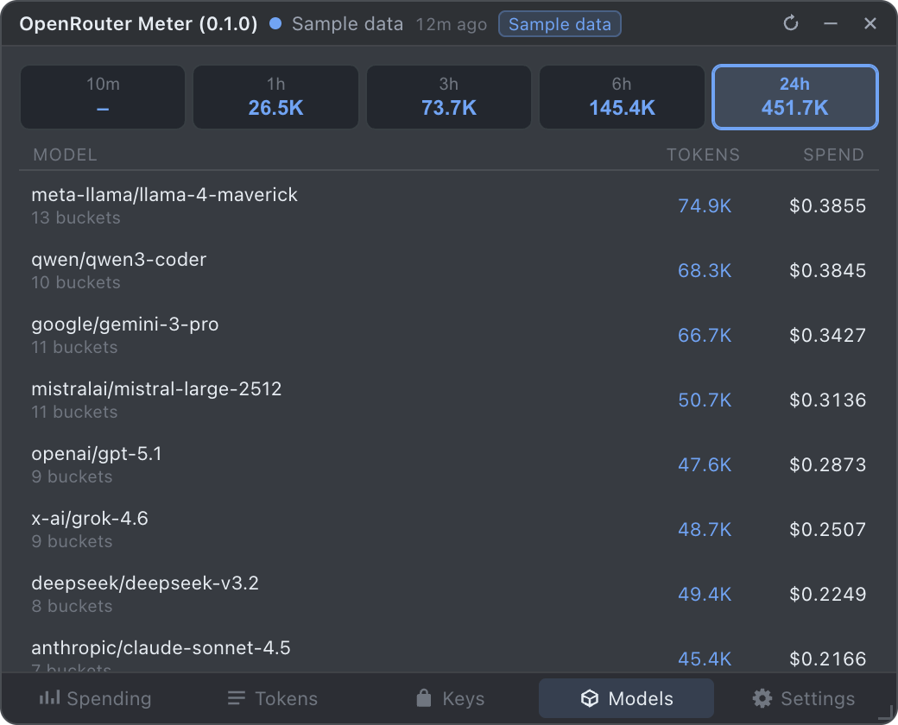
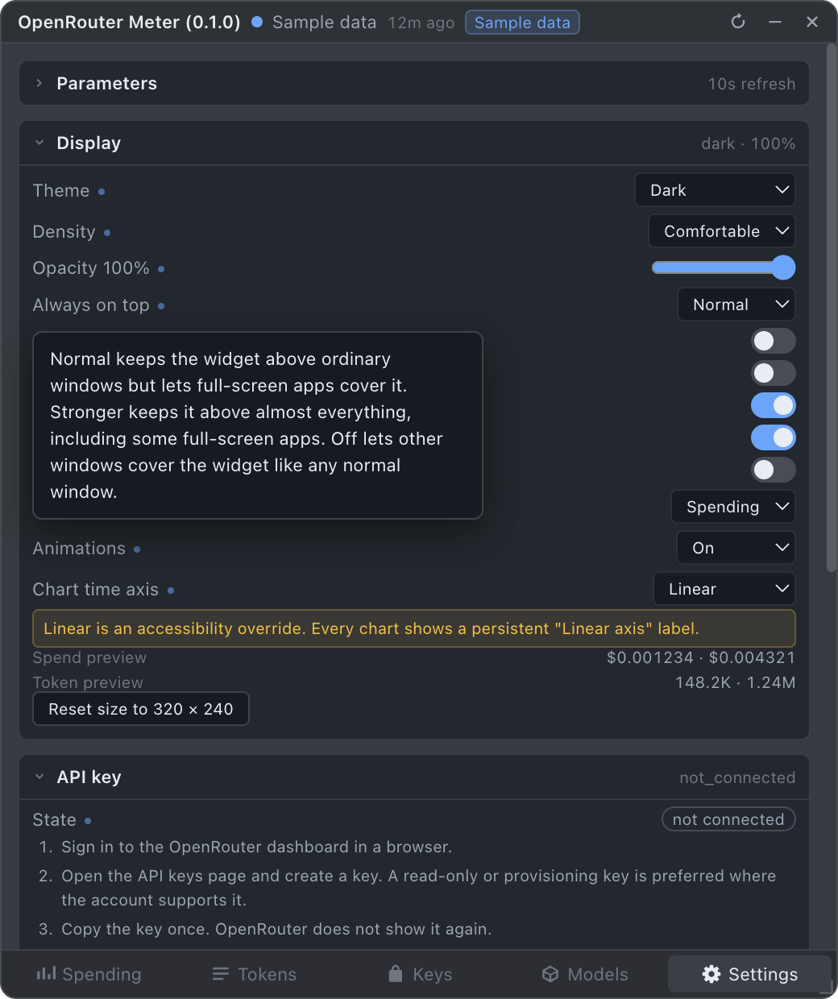
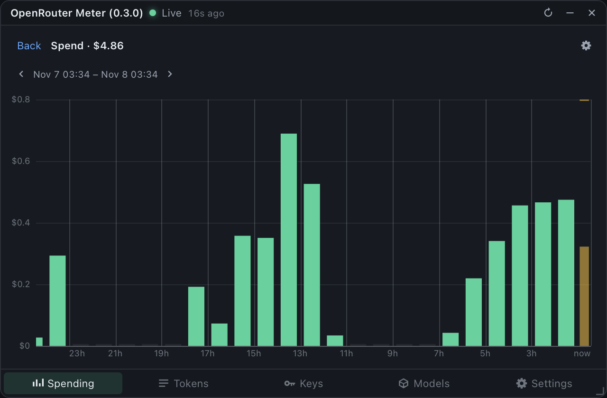

# OpenRouter Meter

A frameless, always-on-top desktop widget that shows OpenRouter spending and token
usage. It is a Tauri app: the OpenRouter credential lives in the OS credential
store, collection happens in the Rust process, and history is kept in a local
SQLite database. The UI is bundled into the binary and runs in the system
WebKit view, so there is no browser runtime to ship — the DMG is under 3 MB.

This is the macOS build. The same source targets Windows and Linux; see
[Platform notes](#platform-notes).


## Screenshots

| | |
|---|---|
|  |  |
|  |  |
|  |  |
|  |  |
|  |  |

All screenshots are rendered from the built-in sample data, so no real account
figures appear in them.

## Download the macOS app

Prebuilt DMGs are published on the
[Releases](https://github.com/Cohibastyle/OpenRouterMeter/releases) page: one for
Apple silicon (`arm64`) and one for Intel (`x64`). Open the DMG and drag
**OpenRouter Meter** to Applications.

The builds are unsigned and not notarized. On first launch, macOS Gatekeeper
blocks the app; allow it in **System Settings → Privacy & Security → Open Anyway**,
or clear the quarantine flag:

```bash
xattr -dr com.apple.quarantine "/Applications/OpenRouter Meter.app"
```

## Requirements

- macOS 12 or later (Apple silicon or Intel)
- Node.js 22 or later
- No OpenRouter account is required to explore the widget: it starts with clearly
  labeled sample data.

## Install and run

```bash
npm install
npm run build
npm start
```

`npm start` builds and launches the widget. On first launch it appears in the
top-right of the primary display at 320 x 240, above normal windows, with a menu
bar item and no Dock icon.

## Connect an OpenRouter account

1. Open the widget and select the **Settings** tab.
2. Expand **API key**.
3. Follow the six inline steps. The key is created on the
   [OpenRouter API keys page](https://openrouter.ai/settings/keys).
4. Paste the key and choose **Connect**. The widget verifies it with a single
   read-only call before saving.

The key is encrypted through the macOS Keychain via `security-framework`. It is never written to the database, a settings file, a log, or the
renderer. If OS encryption is unavailable, the widget refuses to persist the key
and keeps it in memory for the session only.

A **management key** is required for the live source. Analytics queries and the
key list both need one; with a non-management key the widget falls back to the
older activity feed and says so in the UI.

## Using the widget

Five tabs, always in this order:

| Tab | Accent | What it shows |
|---|---|---|
| Spending | green | Rolling window strip, spend for the selected interval, spend chart |
| Tokens | orange | Rolling window strip, token total for the selected interval, token chart |
| Keys | purple | Rolling window strip, then spend and tokens per API key |
| Models | blue | Rolling window strip, then spend and tokens per model |
| Settings | slate | Parameters, display, API key, version, support, diagnostics, scope, log |

The **Log** is not a tab. It is the last group in Settings, next to the other
diagnostic material.

Charts are inline on the Spending and Tokens tabs. Clicking the headline value
opens a full-size chart subview; `Escape` or **Back** returns to the tab.

### Rolling window summary

The strip reports five trailing windows: `10m`, `1h`, `3h`, `6h`, `24h`. They are
trailing and overlapping, never additive. `24h` is a trailing 24 hours, not the
calendar day.

The cells double as range buttons. Selecting one highlights it and redraws the
headline and chart for that interval.

A window is shown only when it can be computed honestly. If the finest source
granularity is coarser than a quarter of the window, the cell reads `–` with
reason `source_granularity` rather than an interpolated guess. Missing is never
rendered as zero. A cell marked `~` has partial coverage, for example because
collection started inside the window.

### Time axis

Every graph uses a linear time axis: each bucket gets a width in proportion to the
time it covers, and the vertical grid lines follow it.

```
x(t) = (t - t_start) / (t_end - t_start)
```

The axis is a rendering choice only; it does not change period selection, bin
boundaries, or totals.

### Resizing

Drag the handle in the bottom-right corner. The layout reflows continuously from a
180 x 120 badge to a full dashboard with no clipping and no horizontal scrolling.

| Width | Class | Height | Class |
|---|---|---|---|
| below 240 | XS | below 200 | Short |
| 240–359 | S | 200–399 | Regular |
| 360–519 | M | 400+ | Tall |
| 520–799 | L | | |
| 800+ | XL | | |

Derived modes: **Micro** (XS width or Short height), **Compact** (S + Regular),
**Standard** (M, or L/XL + Regular), **Expanded** (L/XL + Tall).

The chart appears whenever there is room for a legible plot: always in Expanded,
and in Standard only above 280 px of height. Below that the chart is hidden rather
than squeezed under its legibility floor.

## Keyboard

| Key | Action |
|---|---|
| `1`–`5` | Select a tab |
| `Escape` | Close a subview |
| `Tab` / `Shift+Tab` | Move focus |
| `Cmd+Shift+O` | Show or hide the widget |
| `Cmd+Shift+G` | Toggle ghost mode (click-through) |

## Menu bar item

Show or hide, always-on-top toggle, ghost mode, refresh now, open settings, quit.

## Development

```bash
npm run build      # bundle the UI into dist/renderer
npm run typecheck  # tsc --noEmit
npm test           # 137 unit tests for accounting, time, axis, layout, redaction
npm run dev        # build the UI and launch the app
npm run capture    # render each size class to PNG for review
npm run dist:mac   # build a distributable DMG
```

Rust needs to be on `PATH` for the app targets; the frontend build alone only
needs Node. The Tauri CLI is a devDependency, so `npm install` provides it — no
global `cargo install tauri-cli` is needed.

The Rust side has its own suite:

```bash
cargo test --manifest-path src-tauri/Cargo.toml
```

### Bundle size

The DMG is **2.9 MB**. Nothing is pruned to get there: the UI bundle is under
300 KB and the Rust binary 6.1 MB unpacked, and there is no browser runtime
because the app renders in the system WebKit view. That is the whole reason the
Tauri port exists — the same app was 80 MB with Electron, 27× larger, almost
entirely Chromium.

`Cargo.toml` sets the release profile to `lto = true`, `opt-level = "s"`,
`panic = "abort"` and `strip = true`, which accounts for most of the difference
between a debug and a release build.

### Project layout

```
src-tauri/src/       window, tray, shortcuts, bridge, state, database
src-tauri/src/       collector (reqwest), accounting, chart, snapshot
src-tauri/frontend/  the Tauri bridge that installs window.widget
src/renderer/        views, components, responsive styles
src/renderer/charts/ time scale, tick generator, bar renderer, hit testing
src/shared/          types, schemas, money, formatting, time axis, layout
tests/               unit tests
docs/                platform, API, security, data model, operations notes
sample-data/         safe fixtures with no real secrets
```

### Security model

- The UI runs in the system WebKit view with no Node access at all.
- `tauri.conf.json` sets a strict CSP: `default-src 'none'`, scripts and styles
  only from the bundle, `connect-src 'none'`, and no remote origins.
- `tauriBridge.ts` exposes a fixed set of named `WidgetApi` methods. There is no
  generic invoke passthrough to the Rust side.
- Every command validates and bounds its arguments.
- Logs are redacted at write time, not at display time.
- No telemetry, no analytics, no crash upload. The only outbound traffic is to
  OpenRouter.

## Data locations

| What | Where |
|---|---|
| Database | `~/Library/Application Support/OpenRouter Meter/widget.db` |
| Logs | `~/Library/Application Support/OpenRouter Meter/logs/widget.log` |
| Credential | `~/Library/Application Support/OpenRouter Meter/credentials/openrouter.bin` (encrypted) |
| Window state | `~/Library/Application Support/OpenRouter Meter/window-state.json` |

Settings → Diagnostics can open these folders, export data, vacuum the database,
and clear all local data.

## Platform notes

- **macOS**: floating window level, visible across Spaces, no Dock icon, menu bar
  item. The stronger always-on-top level also covers full-screen apps.
- **Windows**: reasserts topmost after focus changes; hidden from the taskbar.
- **Linux X11**: sets the always-on-top hint and reapplies it after a workspace
  switch.
- **Linux Wayland**: most compositors do not let a client force always-on-top.
  The widget detects the session type and shows a one-time notice explaining that
  the rule must be set in the compositor, or the X11 session used.

## Known limitations

These are properties of the OpenRouter API, verified against a live account, not
defects in the widget. Each one is stated in the UI rather than hidden.

- **The live source is `/analytics/query`, not `/activity`.** The older activity
  endpoint returns a fixed set of daily rows that can stop several days behind
  today and ignores every date filter. The analytics endpoint is what the
  OpenRouter dashboard itself uses: it reports the current day, supports minute,
  hour, and day granularity, and can break spend down by key. The widget uses it
  as the primary source and keeps `/activity` only as a fallback.
- **A management key is required for the live source.** Analytics and the key
  list both need one. With a non-management key the widget falls back to the
  activity feed, where the short windows cannot be computed and per-key data is
  unavailable.
- **Individual generations are not exposed.** Analytics returns aggregates, so
  the widget shows spend and tokens per bucket, not one row per request. The
  per-generation list on openrouter.ai is not part of the public API. The Keys
  and Models tabs therefore present a breakdown of the same aggregates the charts
  use, and say so rather than labelling minute buckets as individual requests.
- **Today is exact only if the widget was running at midnight.** The credits
  counter supplies a live cross-check, but its derivation needs a reading from
  before the day started. Without one the figure is partial and the UI says
  `live since HH:MM` rather than implying a full day.
- **A management key reports its own usage as zero.** `usage_daily` and friends
  are `0` for a management key because the usage belongs to the account. The
  widget ignores those fields in that case.
- **The key label is the masked key.** OpenRouter returns the masked credential
  as `label` for a management key. The widget shows `Management key` instead and
  never persists a key-shaped label.
- **No account-wide request feed is confirmed**, so request coverage is reported
  as `Selected apps` rather than `Full account`.
- **Update checks are a stub.** Settings → Version reports `up_to_date` without
  contacting a server.
- Currency is USD only in this release.

## Troubleshooting

**Sample data still shows after entering a key.** Sample rows are purged the
moment a real credential is verified, and the sample flag is derived from the
connection state. If you upgraded from an earlier build, the stale rows are
removed on the next launch and the removal is logged as
`removed N sample request records`.

**The banner says the saved key could not be read.** The credential file exists
but the OS would not decrypt it, typically because the Keychain entry was reset.
Re-enter the key in Settings → API key.

**Today shows `$0.00` but the month is not zero.** Expected. OpenRouter has not
published today's activity yet. The lag line under the metrics names the newest
reported date.

**The five window cells are all dashes.** Expected with a non-management key.
The activity fallback only publishes daily totals, so a 10 minute window cannot be
computed honestly. The widget refuses to interpolate one.

**The Keys tab says per-key data is unavailable.** Expected on the activity
fallback. The analytics source carries key identity; the activity feed does not.

## License

MIT
