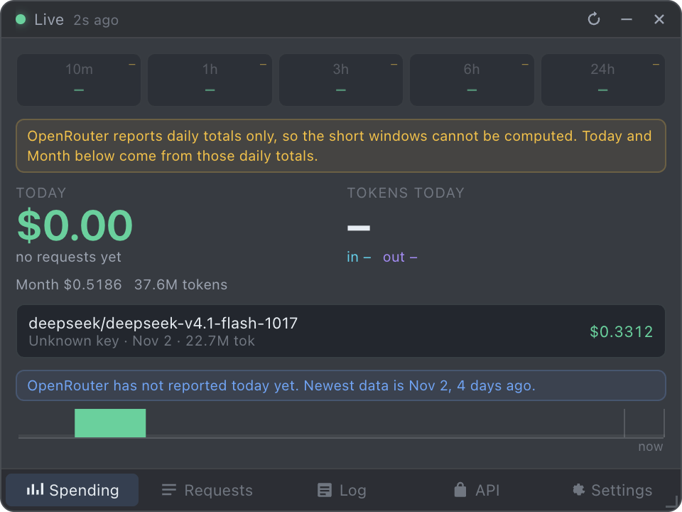
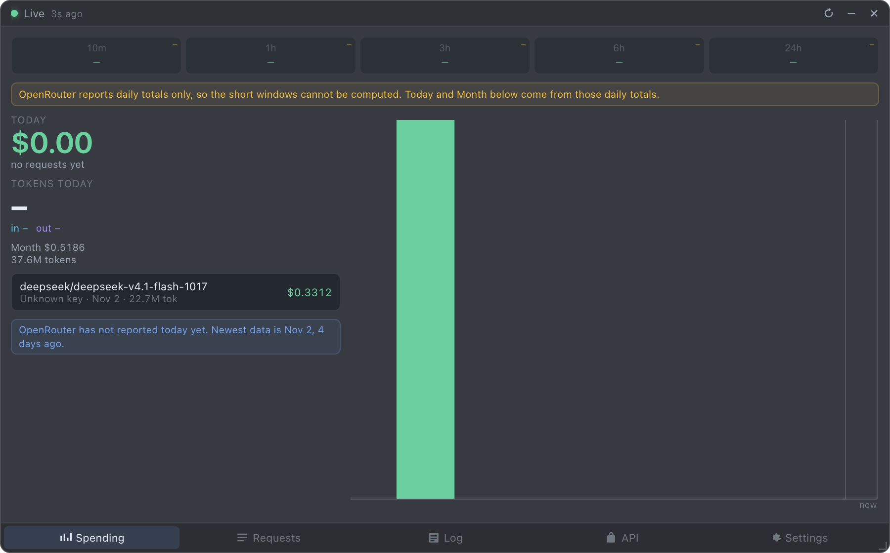
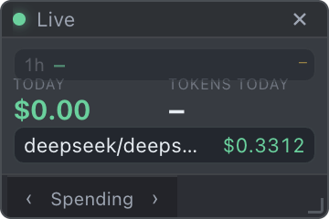
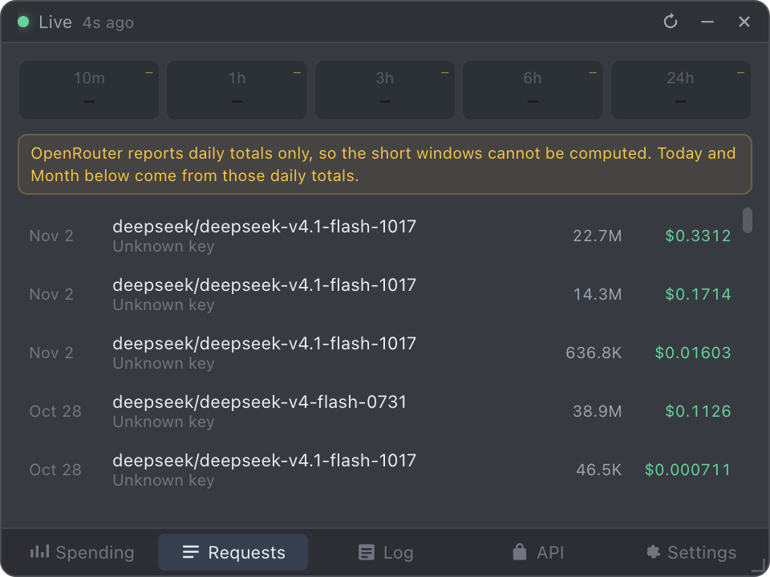
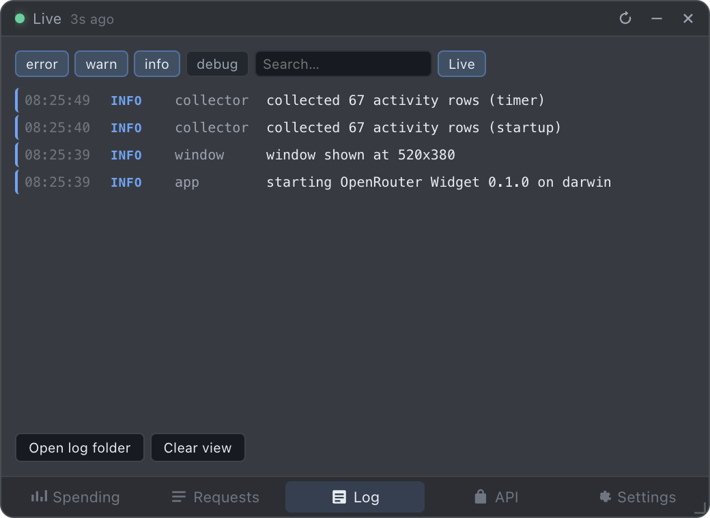
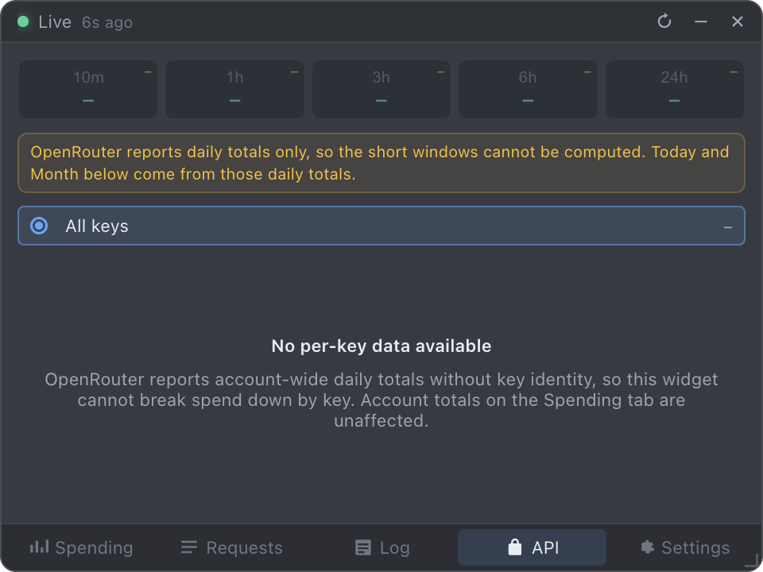
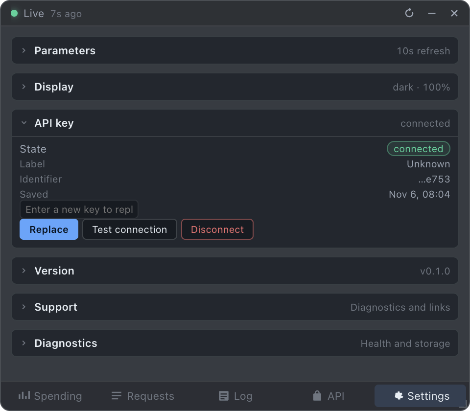
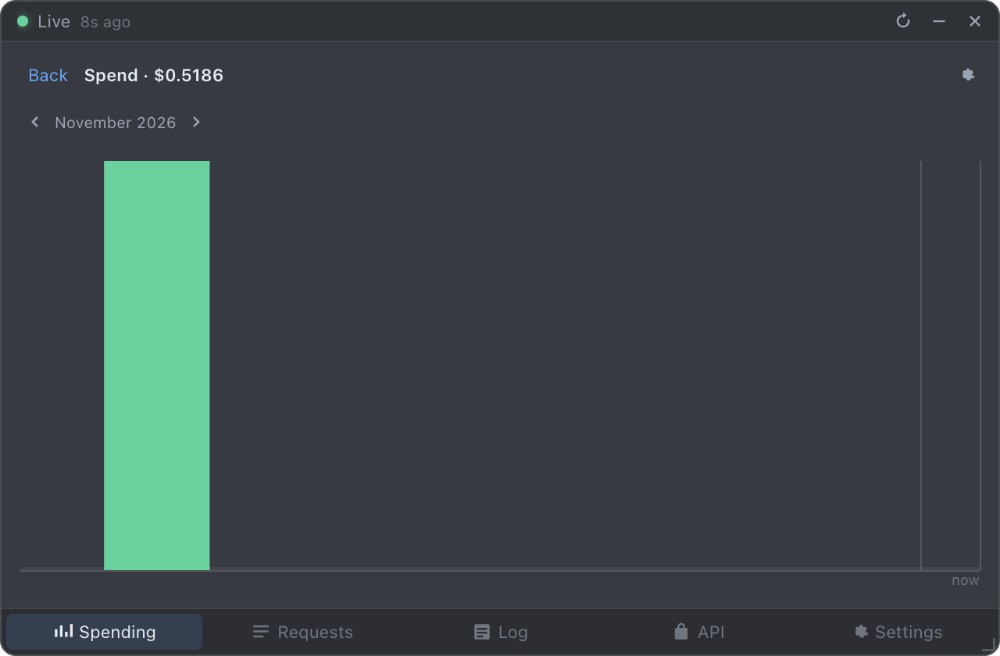
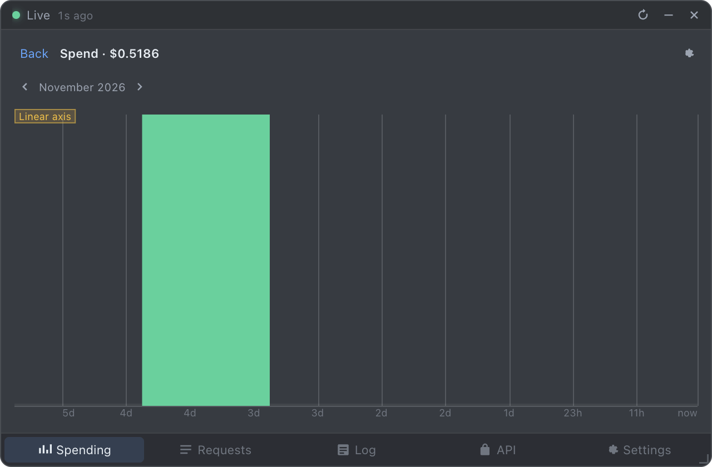

# OpenRouter Meter

A frameless, always-on-top desktop widget that shows OpenRouter spending, token
usage, charts, and the latest request. It is a self-contained Electron app: the
OpenRouter credential lives in the OS credential store, collection happens in the
main process, and history is kept in a local SQLite database.

This is the macOS build. The same source targets Windows and Linux; see
[Platform notes](#platform-notes).



| | |
|---|---|
|  |  |
|  |  |
|  |  |
|  |  |

## Download the macOS app

Prebuilt DMGs are published on the
[Releases](https://github.com/Cohibastyle/OpenRouterMeter/releases) page: one for
Apple silicon (`arm64`) and one for Intel (`x64`). Open the DMG and drag
**OpenRouter Meter** to Applications.

The builds are unsigned and not notarized. On first launch, macOS Gatekeeper
blocks the app; allow it in **System Settings → Privacy & Security → Open Anyway**,
or clear the quarantine flag:

```bash
xattr -dr com.apple.quarantine "/Applications/OpenRouter Meter.app"
```

## Requirements

- macOS 12 or later (Apple silicon or Intel)
- Node.js 22 or later
- No OpenRouter account is required to explore the widget: it starts with clearly
  labeled sample data.

## Install and run

```bash
npm install
npm run build
npm start
```

`npm start` builds and launches the widget. On first launch it appears in the
top-right of the primary display at 320 x 240, above normal windows, with a menu
bar item and no Dock icon.

If the Electron binary did not download during `npm install`, fetch it once:

```bash
npm run setup:electron
```

## Connect an OpenRouter account

1. Open the widget and select the **Settings** tab.
2. Expand **API key**.
3. Follow the six inline steps. The key is created on the
   [OpenRouter API keys page](https://openrouter.ai/settings/keys).
4. Paste the key and choose **Connect**. The widget verifies it with a single
   read-only call before saving.

The key is encrypted with Electron `safeStorage`, which maps to the macOS
Keychain. It is never written to the database, a settings file, a log, or the
renderer. If OS encryption is unavailable, the widget refuses to persist the key
and keeps it in memory for the session only.

## Using the widget

Five tabs, always in this order:

| Tab | What it shows |
|---|---|
| Spending | Rolling window strip, today and month totals, current-day trend, latest request |
| Requests | Rolling window strip with request counts, then recent requests newest first |
| Log | The widget's own application event log |
| API | Scope selector: all keys or one specific key, plus a per-key breakdown |
| Settings | Parameters, display options, API key, version, support, diagnostics |

Charts is a subview, not a tab. Open it from a summary strip cell or from a total;
`Escape` or **Back** returns to the view that opened it.

### Rolling window summary

The strip reports five trailing windows: `10m`, `1h`, `3h`, `6h`, `24h`. They are
trailing and overlapping, never additive. `24h` is a trailing 24 hours, not the
calendar day.

A window is shown only when it can be computed honestly. If the finest source
granularity is coarser than a quarter of the window, the cell reads `–` with
reason `source_granularity` rather than an interpolated guess. Missing is never
rendered as zero.

### Logarithmic time axis

Every graph uses a logarithmic X axis, so recent data occupies most of the width
and older data compresses toward the left. Vertical grid lines compress with it.

```
x(t) = 1 - (log(a) - log(a_min)) / (log(a_max) - log(a_min))     a = t_end - t
```

The axis is a rendering choice only: it does not change period selection, bin
boundaries, or totals. A linear axis exists as an accessibility override in
Settings → Display, off by default, and shows a persistent `Linear axis` label.

### Resizing

Drag any edge or corner. The layout reflows continuously from a 180 x 120 badge to
a full dashboard with no clipping and no horizontal scrolling.

| Width | Class | Height | Class |
|---|---|---|---|
| below 240 | XS | below 200 | Short |
| 240–359 | S | 200–399 | Regular |
| 360–519 | M | 400+ | Tall |
| 520–799 | L | | |
| 800+ | XL | | |

Derived modes: **Micro** (XS width or Short height), **Compact** (S + Regular),
**Standard** (M, or L/XL + Regular), **Expanded** (L/XL + Tall).

## Keyboard

| Key | Action |
|---|---|
| `1`–`5` | Select a tab |
| `Escape` | Close a subview |
| `Tab` / `Shift+Tab` | Move focus |
| `Cmd+Shift+O` | Show or hide the widget |
| `Cmd+Shift+G` | Toggle ghost mode (click-through) |

## Menu bar item

Show or hide, always-on-top toggle, ghost mode, refresh now, open settings, quit.

## Development

```bash
npm run build      # bundle main, preload, and renderer into dist/
npm run typecheck  # tsc --noEmit
npm test           # unit tests for accounting, time, axis, layout, redaction
npm run selftest   # launch the app and run 11 runtime checks
npm run capture    # render each size class to PNG for review
```

`npm run capture` writes images to
`~/Library/Application Support/OpenRouter Meter/captures/`.

### Project layout

```
src/main/            window, tray, shortcuts, collectors, database, IPC
src/main/logging/    structured logger, redaction, rotation, ring buffer
src/main/diagnostics/ environment, storage, performance, bundle redaction
src/preload/         the context bridge surface and its types
src/renderer/        views, components, responsive styles
src/renderer/charts/ log time scale, tick generator, bar renderer, hit testing
src/shared/          types, schemas, money, formatting, log axis, layout
tests/               unit tests
docs/                platform, API, security, data model, operations notes
sample-data/         safe fixtures with no real secrets
```

### Security model

- `contextIsolation: true`, `nodeIntegration: false`, `sandbox: true`.
- The renderer loads only local files, with a strict CSP and no remote origins.
- The preload exposes a fixed set of named methods. There is no generic
  `invoke(channel, payload)` passthrough.
- Every IPC handler validates and bounds its arguments.
- Logs are redacted at write time, not at display time.
- No telemetry, no analytics, no crash upload. The only outbound traffic is to
  OpenRouter and the update check.

## Data locations

| What | Where |
|---|---|
| Database | `~/Library/Application Support/OpenRouter Meter/widget.db` |
| Logs | `~/Library/Application Support/OpenRouter Meter/logs/widget.log` |
| Credential | `~/Library/Application Support/OpenRouter Meter/credentials/openrouter.bin` (encrypted) |
| Window state | `~/Library/Application Support/OpenRouter Meter/window-state.json` |

Settings → Diagnostics can open these folders, export data, vacuum the database,
and clear all local data.

## Platform notes

- **macOS**: floating window level, visible across Spaces, no Dock icon, menu bar
  item. The stronger always-on-top level also covers full-screen apps.
- **Windows**: reasserts topmost after focus changes; hidden from the taskbar.
- **Linux X11**: sets the always-on-top hint and reapplies it after a workspace
  switch.
- **Linux Wayland**: most compositors do not let a client force always-on-top.
  The widget detects the session type and shows a one-time notice explaining that
  the rule must be set in the compositor, or the X11 session used.

## Known limitations

These are properties of the OpenRouter API, verified against a live account, not
defects in the widget. Each one is stated in the UI rather than hidden.

- **Short windows cannot be computed.** The activity endpoint reports per-day,
  per-model aggregates and ignores `granularity` and `interval`. The `10m`, `1h`,
  `3h`, `6h`, and `24h` cells therefore report `unavailable` with reason
  `source_granularity`. A note above the strip explains this once.
- **The live source is `/analytics/query`, not `/activity`.** The older activity
  endpoint returns a fixed set of daily rows that can stop several days behind
  today and ignores every date filter. The analytics endpoint is what the
  OpenRouter dashboard itself uses: it reports the current day, supports minute
  and hour granularity, and can break spend down by key. The widget uses it as
  the primary source and keeps `/activity` only as a fallback.
- **A management key is required for the live source.** Analytics and the key
  list both need one. With a non-management key the widget falls back to the
  activity feed and says so.
- **Individual generations are not exposed.** Analytics returns aggregates, so
  the widget shows spend and tokens per bucket, not one row per request. The
  per-generation list on openrouter.ai is not part of the public API. The Usage
  tab therefore presents a breakdown of the same aggregates the charts use,
  grouped by model, key, or provider, and says so rather than labelling minute
  buckets as individual requests.
- **Today is exact only if the widget was running at midnight.** The credits
  counter supplies a live cross-check, but its derivation needs a reading from
  before the day started. Without one the figure is partial and the UI says
  `live since HH:MM` rather than implying a full day.
- **No per-key breakdown.** Activity rows carry no `key_id` or `key_name`, so the
  API tab reports that per-key data is unavailable instead of showing an empty
  panel. Account totals are unaffected.
- **A management key reports its own usage as zero.** `usage_daily` and friends
  are `0` for a management key because the usage belongs to the account. The
  widget ignores those fields in that case.
- **The key label is the masked key.** OpenRouter returns the masked credential
  as `label` for a management key. The widget shows `Management key` instead and
  never persists a key-shaped label.
- No account-wide request feed is confirmed, so latest-request coverage is
  reported as `Selected apps` rather than `Full account`.
- Currency is USD only in this release.

## Troubleshooting

**Sample data still shows after entering a key.** Fixed. Sample rows are purged
the moment a real credential is verified, and the sample flag is derived from the
connection state. If you upgraded from an earlier build, the stale rows are
removed on the next launch and the removal is logged as
`removed N sample request records`.

**Today shows `$0.00` but the month is not zero.** Expected. OpenRouter has not
published today's activity yet. The lag line under the metrics names the newest
reported date.

**The five window cells are all dashes.** Expected on a live account. The source
only publishes daily totals, so a 10 minute window cannot be computed honestly.
The widget refuses to interpolate one.

**The API tab says no per-key data.** Expected. The activity endpoint carries no
key identity.

## License

MIT
